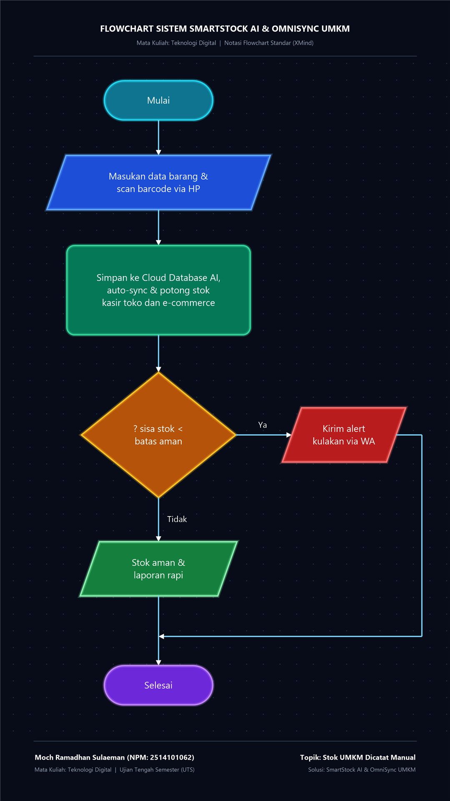

# UTS Teknologi Digital
## SmartStock AI & OmniSync UMKM™: Solusi Mengatasi Stok UMKM yang Dicatat Manual

### 🎓 Identitas Mahasiswa
- **Nama:** Moch Ramadhan Sulaeman
- **NPM:** 2514101062
- **Mata Kuliah:** Teknologi Digital (Ujian Tengah Semester)
- **Topik Kasus:** Stok UMKM Masih Dicatat Manual
- **Solusi Digital:** SmartStock AI & OmniSync UMKM™

---

### 🌐 Tautan Live GitHub Pages (Bisa Dibuka Langsung dari HP / Laptop)
- 🎬 **Studio Video Animasi (9:16) Reels:**  
  [https://ramadhannsu27.github.io/uts-stok-umkm/video_studio.html?v=20261110_final](https://ramadhannsu27.github.io/uts-stok-umkm/video_studio.html?v=20261110_final)
- 📊 **Dashboard Utama:**  
  [https://ramadhannsu27.github.io/uts-stok-umkm/?v=20261110_final](https://ramadhannsu27.github.io/uts-stok-umkm/?v=20261110_final)
- 📄 **Dokumen Laporan UTS Lengkap:**  
  [https://ramadhannsu27.github.io/uts-stok-umkm/UTS_Moch_Ramadhan_Sulaeman_2514101062.html?v=20261110_final](https://ramadhannsu27.github.io/uts-stok-umkm/UTS_Moch_Ramadhan_Sulaeman_2514101062.html?v=20261110_final)
- 🖼️ **Gambar Flowchart Sistem Langsung:**  
  [https://ramadhannsu27.github.io/uts-stok-umkm/flowchart_xmind.png?v=20261110_final](https://ramadhannsu27.github.io/uts-stok-umkm/flowchart_xmind.png?v=20261110_final)

---

### 📊 Diagram Flowchart Sistem (Notasi Standar + Blueprint Neon)
Format 9:16 vertikal (Mulai &rarr; Input Scan &rarr; Proses Cloud Auto-Sync &rarr; Cek Batas Stok &rarr; Alert WA / Stok Aman &rarr; Selesai):

  

---

### 🎨 Visual Outro Scene 6 (Pak Joko & Rekan UMKM Naik Kelas)

  

---

### 📂 Struktur Berkas Repositori
1. **`index.html`** - Dashboard web interaktif yang merangkum seluruh paket tugas UTS, tautan studio video, dan galeri aset adegan.
2. **`video_studio.html`** - Studio pemutar dan perekam video animasi explainer format vertikal 9:16 (Instagram Reels / TikTok) lengkap dengan transisi dinamis, efek kamera 2.5D, teks karaoke tersinkronisasi, dan perekam audio mikrofon/AI.
3. **`flowchart_xmind.png`** - Diagram alir arsitektur sistem resolusi tinggi 1080x1920 (gaya blueprint neon, panah rapi & panjang tanpa ikon bulat di shape).
4. **`UTS_Moch_Ramadhan_Sulaeman_2514101062.html`** & **`.md`** - Dokumen laporan akademik lengkap menjawab 7 pertanyaan UTS, analisis akar masalah, 3 fitur SmartStock AI, flowchart sistem, tabel komparasi sebelum-sesudah, serta naskah storyboard 6 adegan (120 detik).
5. **`scene1.jpg` – `scene6.jpg`** - Aset visual ilustrasi gaya 2D Flat Vector kualitas tinggi berformat 9:16:
   - *Scene 1:* Masalah Stok Manual (Pak Joko stres di meja kasir)
   - *Scene 2:* Dampak Fatal Pembatalan Pesanan (*Overselling* & Bintang 1)
   - *Scene 3:* Solusi SmartStock AI di Smartphone
   - *Scene 4:* Alur Kerja 3-Langkah (Barcode Scan, Cloud Sync, WA Bot)
   - *Scene 5:* Manfaat & Hasil Sukses (+80% Hemat Waktu & Omzet Naik)
   - *Scene 6:* Outro, Slogan, dan Identitas Mahasiswa (Pak Joko & Rekan UMKM)
6. **`UTS_Stok_UMKM_GitHub.zip`** - Paket arsip lengkap berisi seluruh file tugas UTS siap unduh.

---

### 🚀 Cara Menjalankan Proyek
1. Buka file **`index.html`** di browser (Google Chrome / Edge / Safari).
2. Klik tombol **"Buka Studio & Rekam Video"** untuk memutar animasi video 9:16.
3. Website ini sudah aktif live di GitHub Pages!
