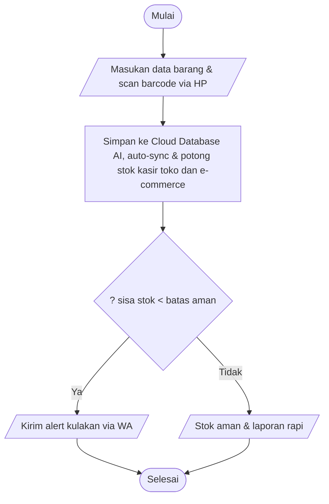
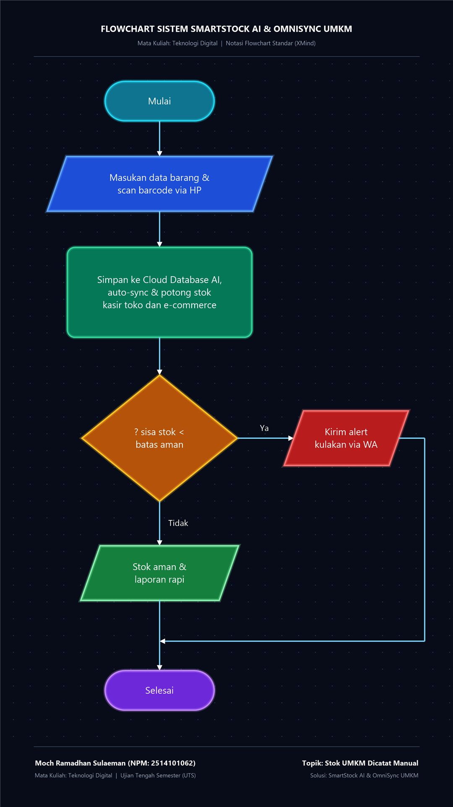

# LAPORAN UJIAN TENGAH SEMESTER (UTS)
## MATA KULIAH: SISTEM TEKNOLOGI
**Topik:** Analisis Masalah, Perancangan Solusi Digital, dan Storyboard Video Animasi Explainer  
**Nama Mahasiswa:** Moch Ramadhan Sulaeman  
**NPM:** 2514101062  
**Tema:** E-Commerce / E-Business  
**Kasus / Permasalahan Spesifik:** **Stok UMKM Dicatat Manual** (*Manual Inventory Record Keeping & Stock Discrepancy in MSMEs*)

---

## BAGIAN I: IDENTITAS & DESKRIPSI TUGAS

* **Nama Mahasiswa:** Moch Ramadhan Sulaeman
* **NPM:** 2514101062
* **Tema Terpilih:** E-Commerce / E-Business
* **Masalah Spesifik:** Pencatatan Stok Barang UMKM yang Masih Menggunakan Cara Manual (Buku Tulis, Nota Kertas, dan Spreadsheet Terpisah)
* **Nama Inovasi Solusi Digital:** **SmartStock AI & OmniSync UMKM™** (*AI-Powered Mobile Inventory & Multi-Channel Marketplace Synchronization*)
* **Target Output:** Laporan Analisis Lengkap, Flowchart Sistem, Tabel Komparasi, dan Storyboard Video Animasi Vertikal (9:16, 1080×1920 px, Durasi 120 Detik).

---

## BAGIAN II: JAWABAN PERTANYAAN UTS

### 1. Apa Permasalahan Spesifik yang Dipilih dan Siapa Pengguna yang Terdampak?

#### A. Permasalahan Spesifik
Permasalahan yang dipilih adalah **"Pencatatan Stok Barang pada Usaha Mikro, Kecil, dan Menengah (UMKM) yang Masih Dilakukan Secara Konvensional/Manual"** (*Manual Inventory Record-Keeping*).

Hingga saat ini, lebih dari 70% pelaku UMKM di Indonesia masih mengandalkan buku tulis kertas, kartu stok fisik, lembaran nota tercecer, atau catatan spreadsheet Excel terpisah tanpa sinkronisasi langsung. 

Kondisi ini menimbulkan tiga masalah fatal:
1. **Ketidaksesuaian Antara Catatan dan Fisik Asli (*Stock Discrepancy*):** Angka di buku berbeda dengan barang fisik di rak karena lupa dicatat, hilang tercecer, atau rusak tanpa pembukuan.
2. **Keterputusan Toko Fisik dan Toko Online (*Omnichannel Disconnect*):** Pelaku UMKM yang berjualan secara luring (toko offline) sekaligus daring di e-commerce (Shopee, Tokopedia, TikTok Shop) tidak memiliki sistem sinkronisasi otomatis. Ketika barang laku di toko fisik, stok di marketplace online tidak langsung terpotong, berujung pada kasus *overselling* (stok habis di toko fisik tapi tetap terbeli oleh pelanggan online).
3. **Inefisiensi Waktu & Beban Kerja (*Operational Burden*):** Pemilik toko menghabiskan waktu 3 hingga 5 jam setiap akhir pekan hanya untuk menghitung ulang barang (*stock opname*) secara manual dengan tingkat kesalahan manusia (*human error*) yang tinggi.

#### B. Pengguna dan Pihak yang Terdampak
1. **Pemilik UMKM (*Business Owner*):** Mengalami stres operasional, kerugian finansial akibat modal mati (*dead stock*), kerugian kehilangan barang (*shrinkage*), dan terhambatnya ekspansi bisnis.
2. **Karyawan Toko / Kasir / Staf Gudang:** Sering disalahkan saat terjadi selisih stok, kelelahan mental akibat pencatatan berulang, dan kesulitan melayani pelanggan saat jam sibuk.
3. **Konsumen Pembeli:** Mengalami kekecewaan mendalam akibat pesanan tiba-tiba dibatalkan sepihak (*order cancellation*) karena stok barang ternyata habis, padahal status di etalase online masih bertuliskan "Tersedia".
4. **Platform E-Commerce & Ekosistem Bisnis:** Reputasi marketplace terganggu akibat tingginya tingkat pembatalan pesanan oleh penjual (*seller cancellation rate*), serta sulitnya perbankan memberikan pembiayaan usaha karena UMKM tidak memiliki laporan riwayat inventaris yang kredibel.

---

### 2. Bagaimana Proses Konvensional Saat Ini dan Apa Penyebab Masalahnya?

#### A. Alur Proses Konvensional Saat Ini
1. **Barang Masuk (Kulakan):** Pemilik UMKM menerima pasokan barang dari supplier, mencocokkan faktur kertas, lalu menuliskan jumlah stok baru ke dalam buku tulis/buku folio manual.
2. **Transaksi Penjualan Toko Fisik:** Setiap ada pembeli datang, kasir menulis nota bon kertas dan sering kali baru mencatat pengurangan stok di akhir hari kerja.
3. **Pembaruan Manual ke Toko Online:** Jika barang juga dijual di marketplace (Shopee/TikTok Shop), pemilik harus membuka aplikasi penjual di ponsel satu per satu untuk mengubah angka stok secara manual. Jika sedang ramai pembeli, tahap ini kerap terlewatkan.
4. **Perhitungan Berkala (*Stock Opname*):** Di akhir bulan, pemilik menutup toko lebih awal untuk menghitung fisik barang satu demi satu. Sering ditemukan barang hilang tanpa kejelasan atau barang kedaluwarsa di sudut gudang.

#### B. Akar Penyebab Masalah (*Root Causes*)
* **Keterbatasan Literasi Digital & Anggaran UMKM:** Software ERP (*Enterprise Resource Planning*) kelas korporat (seperti SAP atau Oracle) memiliki harga lisensi puluhan juta rupiah dan antarmuka yang terlalu rumit bagi pedagang kecil.
* **Tingginya *Human Error* Saat Jam Sibuk:** Saat antrean kasir memanjang, pencatatan manual sering terlewat atau terjadi salah tulis angka (misal angka 10 terbaca 70).
* **Ketiadaan Integrasi Terpusat (*Siloed Channels*):** Toko fisik, gudang belakang, dan toko online berjalan sendiri-sendiri tanpa jembatan data otomatis.
* **Penyimpanan Berkas Kertas yang Rentan Rusak:** Buku catatan rentan terkena tumpahan air, rayap, sobek, atau hilang.

---

### 3. Apa Dampak Masalah bagi Pengguna atau Organisasi?

| Pihak Terdampak | Dampak Langsung & Kerugian Finansial/Operasional |
| :--- | :--- |
| **Pemilik UMKM** | • **Kerugian Modal Mati (*Dead Stock*):** Barang menumpuk di gudang hingga kedaluwarsa karena tidak terpantau perputarannya.<br>• **Penalti Toko Online:** Toko marketplace terkena poin penalti, pembekuan fitur gratis ongkir, atau penurunan ranking algoritma akibat sering membatalkan pesanan pembeli.<br>• **Kebocoran Arus Kas:** Kehilangan barang atau salah hitung harga modal yang menggerus laba bersih toko hingga 15%–20%. |
| **Konsumen** | • Kekecewaan akibat pesanan dibatalkan mendadak saat barang sangat dibutuhkan.<br>• Waktu terbuang menunggu dana pengembalian (*refund*) masuk kembali ke rekening.<br>• Hilangnya rasa percaya pada toko lokal dan beralih ke minimarket/ritel waralaba besar. |
| **Staf & Karyawan** | • Waktu lembur berjam-jam untuk *stock opname* fisik.<br>• Tekanan psikologis akibat tuduhan selisih barang hilang yang tidak terbukti secara objektif. |

---

### 4. Solusi Teknologi Digital Apa yang Diusulkan? (Minimal Tiga Fitur Utama)

Solusi yang dirancang adalah **"SmartStock AI & OmniSync UMKM™"**, sebuah platform aplikasi seluler cerdas yang dirancang khusus untuk mempermudah operasional pedagang kecil dan menengah dengan mengandalkan kamera smartphone biasa dan kecerdasan buatan.

```
+--------------------------------------------------------------------------+
|                     SmartStock AI & OmniSync UMKM™                       |
+--------------------------------------------------------------------------+
|  [Fitur 1: AI Instant Scan]  [Fitur 2: OmniSync Realtime] [Fitur 3: AI Restock Bot]|
|  Pindai barcode & nota via   Sinkronisasi otomatis stok    Peringatan barang habis &|
|  kamera HP tanpa ketik manual toko offline + marketplace   saran bundling via WA    |
+--------------------------------------------------------------------------+
```

#### Tiga Fitur Utama:

1. **Fitur 1: AI Instant Optical Scanner (Barcode & Nota Faktur OCR)**  
   * **Deskripsi:** Fitur pemindai berbasis *Computer Vision* dan *Optical Character Recognition (OCR)* yang memungkinkan pemilik toko memasukkan data barang baru hanya dalam 1 detik.  
   * **Mekanisme Kerja:** Pemilik toko tidak perlu mengetik nama barang satu per satu. Cukup arahkan kamera smartphone ke barcode barang atau foto lembaran nota tagihan dari supplier, AI secara otomatis membaca nama SKU, jumlah item, harga modal, dan langsung memperbarui database stok cloud secara instan.

2. **Fitur 2: Real-Time Multi-Channel Auto-Sync (Omnichannel Sync)**  
   * **Deskripsi:** Sistem integrasi dua arah otomatis antara mesin kasir toko fisik (POS) dengan etalase e-commerce (Shopee, Tokopedia, TikTok Shop, dan Katalog WhatsApp).  
   * **Mekanisme Kerja:** Setiap kali kasir toko fisik memindai barang yang terjual, sistem SmartStock AI detik itu juga memotong jumlah stok di seluruh etalase marketplace online secara serentak. Tidak ada lagi kejadian barang kosong yang terbeli oleh pembeli online (*Zero Overselling Guarantee*).

3. **Fitur 3: AI Predictive Restock & Dead-Stock Early Warning (WhatsApp AI Assistant)**  
   * **Deskripsi:** Asisten kecerdasan buatan yang menganalisis laju perputaran stok barang (*Inventory Turnover Rate*) dan memberikan rekomendasi aksi langsung ke WhatsApp pemilik toko.  
   * **Mekanisme Kerja:** Algoritma mendeteksi barang mana yang *fast-moving* dan mengirimkan pesan notifikasi: *"Stok Minyak Goreng sisa 5 pouch, perkiraan habis 2 hari lagi. Klik link ini untuk pesan ulang ke supplier"*. Sebaliknya, untuk barang yang macet (*slow-moving*), AI memberikan saran diskon promosi atau paket *bundling* sebelum tanggal kedaluwarsa terlewati.

---

### 5. Bagaimana Alur Kerja Solusi? (Flowchart Sistem)

Alur kerja SmartStock AI menghubungkan proses pengadaan barang (*inbound*), penjualan harian kasir toko fisik & online, hingga pelaporan otomatis.

#### Diagram Alur Kerja (Flowchart)





#### Rincian Langkah Kerja Sistem:
1. **Input Kilat (*Effortless Inbound*):** Pemilik toko mengarahkan kamera ponsel ke nota kulakan atau kardus barang. AI membaca dan mencatat ratusan stok dalam hitungan detik.
2. **Sinkronisasi Otomatis (*Omnichannel Broadcast*):** Angka stok langsung tersebar otomatis ke mesin kasir toko dan etalase marketplace (Shopee, Tokopedia, TikTok Shop).
3. **Pengurangan Serempak (*Simultaneous Deduction*):** Baik terjual di meja kasir maupun laku di marketplace, sistem langsung mengurangi stok secara bersamaan dalam waktu kurang dari 2 detik.
4. **Pengawasan Cerdas (*Predictive Monitoring*):** AI memantau perputaran barang secara 24/7. Pemilik mendapatkan pengingat kulakan tepat waktu dan laporan laba-rugi otomatis tanpa perlu repot menghitung manual di akhir bulan.

---

### 6. Bagaimana Perbandingan Kondisi Sebelum dan Sesudah Penerapan Solusi?

| Parameter Pembanding | Kondisi Sebelum Penerapan (Pencatatan Manual) | Kondisi Sesudah Penerapan (SmartStock AI & OmniSync) |
| :--- | :--- | :--- |
| **Metode Pencatatan** | Buku tulis kertas, nota tercecer, atau spreadsheet manual yang rawan hilang dan rusak. | Database digital terpusat di cloud yang aman, dapat diakses dari smartphone pemilik kapan saja. |
| **Kecepatan Input Barang Masuk** | Butuh 1–2 jam untuk mencatat dan menyalin faktur supplier ke buku catatan. | Cukup 10 detik menggunakan foto kamera HP berbasis AI OCR Scanner. |
| **Sinkronisasi Toko Offline & Online** | Terputus total (*silo*). Angka di marketplace harus diubah manual satu per satu. | Terhubung otomatis secara *real-time* 2 arah. Terjual di toko fisik, etalase online langsung terpotong. |
| **Kasus *Overselling* / Pembatalan** | Sering terjadi (10%–20% pesanan online dibatalkan karena stok di toko fisik sudah habis). | **0% (Nol Kasus)**, toko terbebas dari penalti marketplace dan rating pelanggan tetap terjaga bintang 5. |
| **Waktu *Stock Opname* Fisik** | 3–5 jam tiap akhir pekan, toko terpaksa tutup lebih awal untuk hitung barang. | Otomatis terakumulasi setiap detik; verifikasi fisik hanya butuh 15 menit dengan scan barcode acak. |
| **Pengelolaan Barang Macet (*Dead Stock*)** | Barang kedaluwarsa atau hilang baru ketahuan berbulan-bulan kemudian. | Peringatan dini (*early warning alert*) dan saran promo otomatis dari AI sebelum barang rusak/kedaluwarsa. |

---

### 7. Apa Manfaat, Keterbatasan, dan Risiko Solusi?

#### A. Manfaat Solusi
1. **Bagi Pelaku UMKM:** Menghemat waktu hingga 80%, mengeliminasi kerugian *dead stock* bernilai jutaan rupiah, mencegah toko terkena sanksi marketplace, dan membuka akses permodalan bank berkat laporan keuangan yang rapi dan terverifikasi.
2. **Bagi Konsumen:** Kepastian ketersediaan barang 100%, tidak ada lagi rasa kecewa akibat pembatalan pesanan sepihak, dan pengalaman berbelanja yang cepat serta terpercaya.
3. **Bagi Ekosistem Ekonomi Digital:** Membantu program digitalisasi jutaan UMKM Indonesia, meningkatkan efisiensi rantai pasok lokal, dan menaikkan skala usaha mikro menjadi usaha menengah.

#### B. Keterbatasan Solusi (*Limitations*)
1. **Ketergantungan Infrastruktur Jaringan Internet:** Di daerah pelosok dengan sinyal seluler yang tidak stabil, komunikasi cloud dapat terhambat.  
   *(Solusi/Mitigasi: Aplikasi dirancang dengan arsitektur **Offline-First**. Transaksi kasir tetap bisa berjalan normal saat mati lampu/tanpa sinyal, dan data akan otomatis tersinkronisasi kembali saat ponsel mendeteksi internet).*
2. **Kesesuaian Barcode pada Produk Tradisional:** Produk makanan rumahan atau kerajinan tangan lokal sering kali belum memiliki barcode standar pabrik.  
   *(Solusi/Mitigasi: Aplikasi menyediakan fitur **Generator Barcode/QR Mandiri Gratis** yang bisa dicetak langsung menggunakan printer thermal mini bluetooth seharga Rp 100 ribuan).*

#### C. Risiko dan Mitigasi (Keamanan Data Keuangan)
1. **Risiko Kerahasiaan Data Penjualan (*Financial Data Privacy*):**
   * *Risiko:* Data harga modal kulakan dan omzet harian UMKM rentan disalahgunakan pihak ketiga.
   * *Mitigasi:* Seluruh data transaksi dienkripsi secara *end-to-end* menggunakan protokol AES-256 dan disimpan pada peladen cloud lokal bersertifikasi ISO 27001 yang patuh terhadap UU No. 27 Tahun 2022 tentang Pelindungan Data Pribadi (UU PDP).
2. **Risiko Kehilangan Ponsel Pemilik:**
   * *Risiko:* Jika smartphone kasir/pemilik toko hilang atau rusak, data pembukuan dikhawatirkan ikut musnah.
   * *Mitigasi:* Sistem menggunakan pencadangan cloud otomatis (*cloud backup real-time*). Pemilik cukup login di ponsel baru dengan verifikasi OTP WhatsApp, seluruh data inventaris dan keuangan akan langsung pulih 100%.

---

## BAGIAN III: STORYBOARD VIDEO ANIMASI EXPLAINER (FORMAT 9:16)

* **Format Produksi:** Video Vertikal 9:16 (1080 × 1920 piksel)  
* **Target Durasi:** 120 Detik (2 Menit)  
* **Software Produksi:** Canva (Desain Elemen Vektor 2D Flat) + CapCut (Keyframing Gerak, Voice Over AI, Subtitle Dinamis, SFX)  
* **Gaya Visual:** Modern 2D Flat Vector Motion Graphics (Bersih, ekspresif, tanpa efek 3D realistis berlebihan)  
* **Tokoh Utama:** **Pak Joko** (Pemilik toko sembako & busana UMKM yang ramah dan pekerja keras).

---

### Tabel Storyboard Lengkap (6 Adegan Wajib)

| Adegan & Durasi | Visual & Elemen Grafis (Format Vertikal 9:16) | Aksi Animasi & Motion | Narasi / Voice Over (VO) | Teks di Layar (On-Screen Text) | Sound Effect (SFX) & Musik (BGM) |
| :--- | :--- | :--- | :--- | :--- | :--- |
| **Adegan 1: Masalah**<br>*(00:00 – 00:15)* | **Visual:** Pak Joko duduk lesu di meja toko, memegang kepala yang pusing di depan tumpukan buku tulis kertas lusuh penuh coretan tinta dan nota berhamburan. Di belakangnya rak toko tampak berantakan.<br>**Wajah:** Ekspresi cemas dan bingung. | • Buku catatan melayang masuk dan menumpuk di meja dengan suara tumpukan berat.<br>• Kertas nota berterbangan tertiup angin kartun.<br>• Tanda tanya berputar di atas kepala Pak Joko saat mencari data stok beras dan baju. | *"Pernah nggak, kamu lihat toko UMKM yang masih mencatat stok barang pakai buku tulis tebal dan nota kertas yang gampang hilang? Saat pembeli tanya barang, pemiliknya kebingungan bongkar rak berjam-jam!"* | • "STOK MASIH DICATAT MANUAL?" *(Merah Bold)*<br>• Buku Rusak & Nota Hilang! | • **BGM:** Musik komedi ringan bernuansa cemas (*curious pizzicato*).<br>• **SFX:** Kertas robek (*rip sound*), tumpukan buku menghantam meja (*thud*), suara menghela napas panjang (*sigh*). |
| **Adegan 2: Dampak**<br>*(00:15 – 00:30)* | **Visual Split-Screen Vertikal:**<br>• *Atas:* Layar smartphone pembeli online muncul notifikasi merah: "Pesanan Dibatalkan - Stok Habis". Pembeli marah memberi bintang 1.<br>• *Bawah:* Pak Joko stres di depan laci kasir kosong, sementara barang di sudut gudang menumpuk kedaluwarsa berdebu. | • Notifikasi pop-up merah bergetar di layar HP.<br>• Bintang 5 pecah berjatuhan menjadi bintang 1.<br>• Koin uang melayang keluar dari laci kasir toko.<br>• Teks angka kerugian jutaan rupiah membesar di layar. | *"Akibatnya fatal! Terjadi 'overselling'—pesanan online masuk tapi barang di toko fisik sudah laku. Toko kena penalti bintang satu, pembeli kecewa, dan barang di gudang kedaluwarsa tanpa sadar. Modal jutaan rupiah pun amblas sia-sia!"* | • "Pesanan Dibatalkan!"<br>• "Overselling & Rating Anjlok"<br>• "Rugi Modal Mati!" | • **SFX:** Notifikasi eror keras (*buzz!*), suara kaca pecah (*glass shatter*), koin berhamburan.<br>• **BGM:** Nada tegang melambat. |
| **Adegan 3: Solusi Digital**<br>*(00:30 – 00:50)* | **Visual:** Layar bertransisi cerah menyala. Muncul mockup smartphone modern menampilkan logo aplikasi **SmartStock AI & OmniSync UMKM™** dengan ikon awan hijau menyambungkan kasir toko ke ikon Shopee, Tokopedia, dan TikTok Shop. | • Smartphone meluncur mulus dari bawah layar (*bounce up*).<br>• Ikon awan cloud berdenyut memancarkan garis cahaya ke berbagai logo marketplace.<br>• Pak Joko tersenyum ceria menunjuk ke layar aplikasi. | *"Kini saatnya UMKM naik kelas dengan SmartStock AI! Aplikasi manajemen stok cerdas berbasis AI dan kamera ponsel, menghubungkan toko fisik dan seluruh toko online kamu secara otomatis dalam satu genggaman!"* | • **"SOLUSI CERDAS UMKM:"**<br>• **"SmartStock AI & OmniSync"**<br>• *"Kelola Stok 100% Otomatis!"* | • **BGM:** Berubah drastis menjadi musik *Upbeat Tech Acoustic* ceria, modern, dan penuh optimisme.<br>• **SFX:** Efek suara magis digital (*sparkle chime, digital whoosh*). |
| **Adegan 4: Alur Sistem (3 Langkah)**<br>*(00:50 – 01:15)* | **Visual:** Tiga kotak tahapan berurutan secara vertikal yang bergerak dinamis:<br>1. *Langkah 1:* Kamera HP memindai barcode kardus & nota supplier.<br>2. *Langkah 2:* Awan cloud memotong stok di kasir dan Shopee serentak.<br>3. *Langkah 3:* Notifikasi WhatsApp masuk: "Waktunya Kulakan Minyak Goreng!". | • Sinar laser hijau menyapu barcode barang di layar HP.<br>• Ikon angka stok di marketplace online berkurang otomatis seketika saat kasir scan barang.<br>• Balon chat WhatsApp meluncur masuk dengan centang hijau "Pesan Otomatis Terkirim". | *"Cara kerjanya super gampang dalam tiga langkah! Pertama: Foto nota atau scan barcode barang pakai kamera ponsel. Kedua: Stok otomatis tersinkronisasi secara real-time ke kasir toko dan marketplace online. Ketiga: Dapatkan pengingat pintar di WhatsApp saat stok barang menipis sebelum kehabisan!"* | • **1. Scan Barcode via HP**<br>• **2. Auto-Sync Online & Offline**<br>• **3. Pengingat Kulakan di WA** | • **SFX:** Bunyi scanner kasir (*bip! barcode*), denting sinkronisasi digital (*ding!*), suara notifikasi pesan masuk (*pop!*). |
| **Adegan 5: Manfaat**<br>*(01:15 – 01:40)* | **Visual:** Transformasi toko Pak Joko. Rak toko kini tersusun rapi dengan label kode QR. Pak Joko melayani pelanggan dengan senyum lebar menggunakan HP sebagai mesin kasir. Grafik penjualan hijau melonjak tinggi ke atas. | • Transisi tirai pembersih menyapu layar.<br>• Grafik batang omzet naik drastis meluncur ke atas.<br>• Angka statistik: "Hemat Waktu 80%" dan "Nol Pembatalan Stok" melesat muncul bergantian.<br>• Hujan bintang 5 dan konfeti emas memenuhi layar. | *"Hasilnya luar biasa! Pembukuan seratus persen akurat, nol pembatalan pesanan, hemat waktu hingga delapan puluh persen, dan toko kebanjiran ulasan bintang lima. Bisnis berkembang pesat, pemilik toko tidur nyenyak!"* | • **"Nol Pembatalan Stok!"**<br>• **"Hemat Waktu 80%"**<br>• **"Banjir Ulasan ⭐⭐⭐⭐⭐"** | • **SFX:** Suara kasir mencetak struk (*ka-ching!*), tepuk tangan mini ceria, bunyi kembang api kartun (*pop-pop*).<br>• **BGM:** Musik mencapai puncak tempo energetik. |
| **Adegan 6: Kesimpulan**<br>*(01:40 – 02:00)* | **Visual:** Pak Joko bersama para pelaku UMKM Indonesia tersenyum bangga memegang smartphone mereka. Di tengah layar muncul lencana digital emas, slogan utama, dan kartu identitas mahasiswa Moch Ramadhan Sulaeman. | • Objek terpusat ke logo lencana perisai digital.<br>• Teks kinetik muncul kata demi kata dengan animasi pop rapi.<br>• Fade-out elegan menutup video di detik ke-120. | *"Kelola stok gak perlu bikin pusing. Bersama SmartStock AI, UMKM naik kelas, kelola stok cepat dan pas! Saya Moch Ramadhan Sulaeman, terima kasih."* | • **"UMKM Naik Kelas, Kelola Stok Cepat & Pas!"**<br>• **Digitalisasi Nyata UMKM Indonesia**<br>• *Disusun Oleh: Moch Ramadhan Sulaeman (NPM: 2514101062)* | • **BGM:** Musik melambat lembut menutup video (*outro fade-out*).<br>• **SFX:** Suara denting kaca halus penutup (*soft glass chime*). |

---

## BAGIAN IV: PANDUAN TEKNIS PRODUKSI VIDEO ANIMASI

### 1. Produksi Aset & Animasi di Canva
1. Gunakan rasio kanvas **Vertikal 9:16 (1080 × 1920 px)**.
2. Cari elemen ilustrasi 2D Flat Vector dengan kata kunci: `small shopkeeper vector`, `messy ledger notebook illustration`, `barcode scanner flat`, `cloud sync arrows`, `sales growth chart flat`.
3. Terapkan fitur **"Animate"** Canva:
   * Buku catatan masuk dengan efek **Pop** atau **Tumble**.
   * Sinar pemindai barcode menggunakan animasi **Wipe** vertikal.
   * Grafik penjualan menggunakan animasi **Rise** dari bawah ke atas.

### 2. Penyuntingan, Keyframe, dan Suara di CapCut
1. Masukkan klip Canva atau 6 gambar adegan ke dalam timeline CapCut 9:16.
2. **Keyframing Objek Bergerak:**
   * Di Adegan 1, gunakan keyframe posisi untuk membuat buku melayang dan jatuh menghantam meja.
   * Di Adegan 4, gunakan keyframe untuk menggerakkan garis laser pemindai naik-turun di atas barcode.
3. **Voice Over (Teks ke Suara):** Gunakan fitur *Text-to-Speech* CapCut dengan suara pria Indonesia yang ramah dan bersemangat membacakan naskah narasi.
4. **Auto-Captions:** Gunakan fitur *Keterangan Otomatis* bergaya teks kinetik kuning/putih modern di bagian bawah layar.
5. Ekspor video dalam format **MP4 resolusi 1080p (60/30 fps)** dengan durasi pas 120 detik.

---

### 3. Pernyataan Integritas Akademik & Sumber Aset
1. **Perangkat Lunak:** Canva Pro (Desain grafis 2D flat) & CapCut PC/Mobile (Pengeditan multitrack, keyframing, dan sinkronisasi audio).
2. **Pemanfaatan AI:** Gemini AI untuk perancangan arsitektur SmartStock AI dan penyusunan naskah narasi; CapCut Voice AI untuk sintesis narator.
3. **Lisensi Aset:** Seluruh elemen visual berlisensi Canva Content License dan audio bebas royalti dari CapCut Audio Library.

---
*(Dokumen tugas UTS resmi mata kuliah Sistem Teknologi oleh Moch Ramadhan Sulaeman - NPM: 2514101062).*
